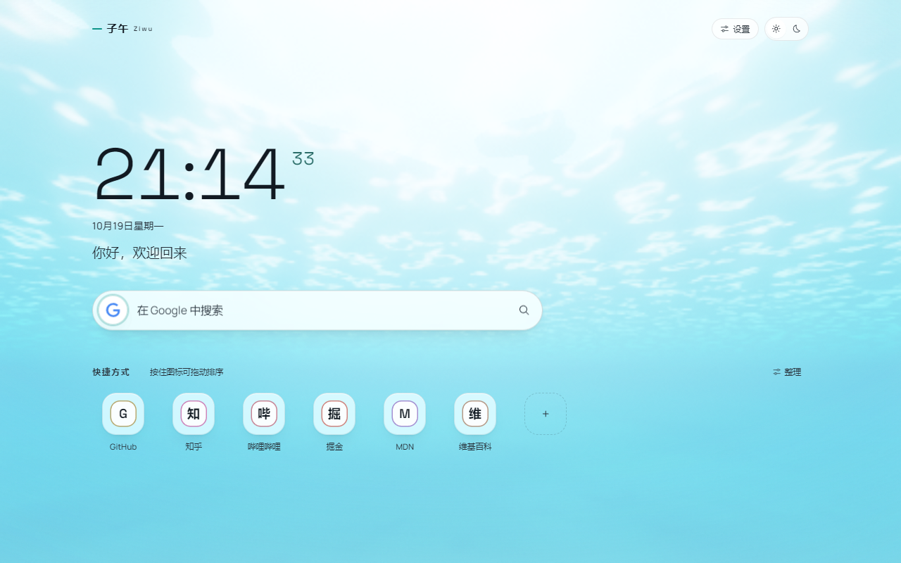
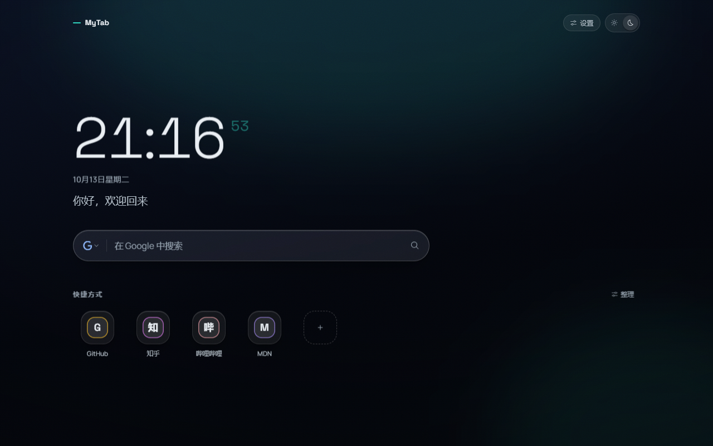
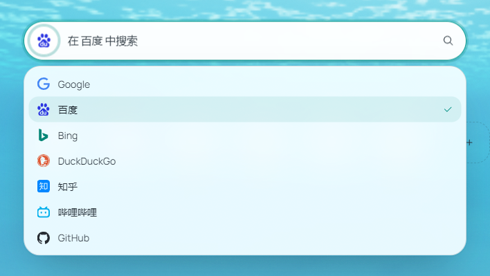

# 子午 Meridiem

一个基于 [`vitesse-webext`](https://github.com/antfu/vitesse-webext) 的 Chrome 扩展：**接管浏览器新标签页**，把「打开新标签页」这件事变成一次干净的停留——时间、搜索、常用站点，就这三样。

技术栈：**Vue 3 + TypeScript + Vite + Unocss + MV3**，包管理器为 pnpm。

视觉上走「精密计时仪器 + 编辑式留白」：左侧一条对齐的中轴（时钟 → 日期问候 → 搜索 → 磁贴），背景是一片**随真实时间变化的 WebGL 水下天光**，材质是玻璃 + 一层胶片颗粒。字体自托管（时钟 Space Grotesk、正文 Manrope），深浅两个主题各有一套完整的语义令牌，见 [设计与工程约束](#设计与工程约束)。





## 架构：四壳一核

理解这个项目的入口是这一条：**四个界面共用同一套组件、同一份 storage，改一处全处生效。**

| 界面 | 目录 | 职责 |
| --- | --- | --- |
| **新标签页** | `src/newtab/` | 核心：时钟 → 日期 → 问候 → 搜索 → 磁贴 + 天光背景 |
| **设置页** | `src/options/` | 主题、默认引擎、问候语、磁贴管理、备份导入导出 |
| **工具栏弹窗** | `src/popup/` | 一个「打开设置」+ 一个主题开关 |
| **侧边栏** | `src/sidepanel/` | 导航 + 磁贴网格 |

四者之间**没有消息通道**：跨页面同步完全靠 `browser.storage.local` 的 `onChanged` 事件，封装在 [useWebExtensionStorage.ts](src/composables/useWebExtensionStorage.ts)。脚手架自带的 `webext-bridge`、content script、「上报上一个标签页标题」那套示例已全部删掉。

代码分三层，边界是硬的：

- **`src/logic/`** —— 纯函数，不碰 Vue / DOM / storage。`sky.ts`、`ambience.ts`、`shortcuts.ts`、`transfer.ts` 都在这一层，所以它们可以被单独喂参数验证。
- **`src/composables/`** —— 响应式封装（`useShortcuts` / `useTheme` / `useFavicon` / `useWebExtensionStorage`）。
- **`src/components/`** —— UI，按需自动注册。

## 功能

### 天光背景

这一页最大的一块，也是它唯一值得做的叙事：**新标签页一天里会被打开几十次，背景如果是一张固定的图，第 30 次打开时它就是死的。** 所以背景真的跟着太阳走——清晨低斜的暖光、正午垂直砸下来的白、日落时被水滤成金色的亮窗、夜里只剩月光那一束。同一个页面，一天里没有两次是一样的。

实现上是三个文件 + 一段 GLSL：`logic/sky.ts`（纯天文与光学）、`logic/skyRenderer.ts`（WebGL 渲染器）、`logic/sky/ocean.ts`（FFT 波场）、`logic/sky/*.glsl`（着色器）、[SkyBackdrop.vue](src/components/SkyBackdrop.vue)（组件层）。

#### 画面不是天空，是水下

相机浸在海里往上看水面，光从水面斜射下来。**这个介质选择不是装饰，它一次解决了三件事：**

1. **曝光有了物理载体。** 空气中的天光亮度几乎只由太阳高度决定，于是「浅色主题在夜里也要够亮」只能靠硬拉曝光，很假。水不一样：水的吸收让**深度直接决定亮度**。
2. **水面的结构有了去处。** 水面波纹把阳光折射、聚焦成一束束亮线（caustics），在海底投出一张会漂移的光网。
3. **色相有了自然的走法。** 水对红光的吸收比蓝绿快一个量级，所以光越往下走越冷、越青。一天的变化于是落在**色温与倾角**上，不落在亮度上。

#### 「主题决定曝光」是深度决定的，不是调出来的

浅色和深色**不是同一张图的明暗两版，是两片水**：

| | 浅色主题 | 深色主题 |
| --- | --- | --- |
| 相机深度 | 贴着水面的浅滩 | 红光早已被吃干净的深水 |
| 海底 | 有 | 没有——往下看就是深渊 |
| 观感 | 被阳光灌满的通透高调青绿，抬头看得见水面上的天光 | 只剩深蓝，水面缩成头顶一个小小的亮斑 |

（具体深度见 `logic/sky.ts` 的 `skyFrameAt`。）

两套主题共享**同一组水的光学常数、同一个太阳**，差别只有一个相机深度。亮度差因此不是「调出来的」，是深度本身的物理结果。

浅水为什么必须这么浅：体积散射沿一条掠射视线积分会**把结构抹平**（一条视线要走十几二十米，细波纹全被平均掉），所以「有东西可看」的区域只能是眼睛够得着水面的区域。海底那个距离也不是随手取的：太近时沙离眼睛只有半米，拍出来是一块没有纹理的白斑；太远时沙面的红光要穿过好几米水才到眼睛，暖色被吃干净、画面下半幅又糊成一块青。具体值见 `logic/sky.ts`。

#### 算出来的，不是画出来的

这些现象是光学常数的直接结果：

- **越往下越冷**——红光吸收快一个量级，同一束光在水面附近是暖白的，走到深处只剩青蓝。
- **抬头只有一个亮窗**——Snell 窗的半角 `asin(1/1.333) ≈ 48.6°`。窗外水面变成一面镜子（全反射），映的是水里的暗，明暗分界不用画。
- **太阳越低，水下的光越「正」**——空气里贴着地面走的光一进水就被 Snell 折射掰进这个锥里（折射方向是真算的），所以不管太阳多低，水下的光都不会躺平。这正是水下照片总显得安静的原因。这个折射方向现在的作用是给海底光网定方向、并参与相函数，而**不再是画出「光柱」**。
- **浅水看得见海底**——白沙把光弹回来，画面因此有了「地平」，不再是一块无方向的渐变，可读性也有了物理下限。

> **一条必须记住的更正：直射光柱已经删掉了**（用户明确要求）。
> 原来的做法是沿视线把水面焦散图案投影回来累加，结论是**这个做法在这套构图里不成立**：焦散是二维图案，投影回来得到的是**斑块而不是柱子**；要让它变成「柱」得让胞元远大于积分长度，结果只是把斑块加粗、还把正文带的明暗幅度拉大、逼着薄膜加重。
> 现在 `waterVolume()` 里只剩**漫射底光**一项（整个天空是一个面光源，从水面均匀漏下来），体积循环变成**纯 ALU，一次纹理都不取**。
> 附带删掉的还有：体积里的粗带焦散调制、星点倒影、逐波长色散。
> ⚠️ 那条「光柱造成了横向条带」的旧论据**是错的**（当时量逐行剖面没有藏掉前景，量到的是搜索栏和磁贴）。删除本身照样成立，但别拿那条论据。

#### 三层降级，任何时候都是「一张好看的背景」

从下到上：

1. **`.sky__fallback`** —— CSS 渐变兜底，用的是 `ambience.ts` 的调色板。WebGL 不可用、还没画出第一帧、上下文丢失、机器太慢被降级，这几种情况下它就是背景，而且**不会跳色**。
2. **`<canvas>`** —— WebGL2。首帧真的画出来了才淡入（避免开页闪黑）。
3. **`.sky__veil`** —— 可读性薄膜。**一层，整幅，均匀**，强度由**探针实测的元素级最坏像素亮度**算出来。它读起来必须是「雾」，不能是「卡片」。

> 薄膜曾经试过「每个正文元素一块带羽化的补丁」。它在对比度数字上有效，但**画面上不成立**：二十多个站名各一块补丁，等于在磁贴栏上横着铺十几条深浅不一的带子，逐行量能看出明显的横向条纹。
> 现在回到一层：驱动量仍然是元素级的最坏值（量在判据所在的位置），只是**渲染**不再逐元素。

#### 闭环自动曝光是保险，不是手段

它读内容区的**真实像素**，把亮度拉回主题该在的区间。节奏是先密后疏：开页头几次探测走大步（「第一眼」要快），之后放慢到只压波纹漂过带来的抖动。切主题时把收敛节奏当「第一眼」重来，并把增益**解析预置**到新主题的量级上，而不是从旧值慢慢爬。

它只做 **±2 档以内的修正**——一旦让它去补 5 档以上的差距，增益会顶到上限、整幅画面糊成一片灰。

闭环**必须在场景空间里做误差**：反读回来的分位数是 ACES + gamma 之后的显示亮度，而增益乘的是 ACES 之前的光。直接拿显示亮度比去乘增益等于假设那条曲线是线性的，可它偏偏在肩部斜率很低——于是「把最亮处往目标拉」每次只能推进一点点，几十次探针都到不了。ACES 的拟合式是二次有理函数，反函数就是一个二次方程，不需要迭代。

#### 主题切换是换水体，不是换颜色

浅色 ↔ 深色是**两片水**：深度差一个量级、曝光差一个量级、俯仰也不一样。这些量如果在**一帧**里同时换掉，画面就是一刀切（实测合成帧亮度在一帧之内掉了 0.82）。

所以参数过渡时长名为 `THEME_BLEND_MS`（值见 `src/logic/skyRenderer.ts`）：所有参数按 smootherstep 插值（两端一阶导为 0，起停都不顿）。**上一版的 720ms 不够**——亮度不是参数的线性函数，深度变化时透过率按 Beer–Lambert 走指数，参数均匀地走、画面亮度却会在中段一头扎下去（720ms 那版实测：一次帧间跳变就有终值的 85%）。摊长之后每帧跳变小一个量级，读起来才是「沉下去」而不是「闪一下」。

`prefers-reduced-motion: reduce` 时传 0，渲染器只画一帧。

#### 性能与位置

水的散射是低频信号 → **低分辨率渲染**再让浏览器放大，肉眼分不出来；目标帧率很低（这片水一分钟才动一点点）；掉帧自动降分辨率；页面不可见就停。开页头一段时间是**热机期**（着色器编译、波场回读标定挤在这里），这段时间的帧不代表稳态性能，所以既不进帧率 EMA、也不参与自适应分辨率。

**它不是演示，是背景。** 相机几乎不动（指针只带一点点视差），波纹漂得很慢——用户是来搜索的，不是来看特效的。

#### 评审用的时间覆盖

天空跟真实时间走，所以评审必须能钉住时刻，否则一轮得等一整天：

```
?sky=6.5                # 今天 06:30
?sky=2026-06-21T05:30   # 指定日期时间
?sky=real / 缺省         # 跟随真实时间
```

这是**只读的调试入口**，不写 storage、不进设置页——它不该成为用户会依赖的功能。`?skydebug=1` 会把渲染器的实时状态挂到 `window.__sky`（供截图脚本读探针）。

### 多引擎搜索框



内置 **Google、百度、Bing、DuckDuckGo、知乎、哔哩哔哩、GitHub** 七个引擎，全部定义在 `src/logic/searchEngines.ts` 的 `searchEngines` 数组里，增删改都只动这一处。

| 操作 | 效果 |
| --- | --- |
| 点输入框左侧图标 | 展开引擎列表，点选切换 |
| 输入框内按 <kbd>Tab</kbd> | 依次轮换引擎，走完一轮后焦点交给浏览器（下一个是搜索按钮，再往下是磁贴） |
| 输入框内按 <kbd>Shift</kbd>+<kbd>Tab</kbd> | 反向轮换；走回起点后焦点退回引擎按钮 |
| 输入关键词后回车 / 点右侧按钮 | 用当前引擎搜索 |
| 回车时按住 <kbd>Ctrl</kbd> / <kbd>⌘</kbd>，或中键点搜索按钮 | 在新标签页打开 |

> **输入法组词期间不抢按键**：`onKeydown` 开头会检查 `event.isComposing`。
> 拼音候选词要靠回车确认、Esc 取消，组词中如果照常处理，用户打「知乎」敲回车选词
> 就会被直接送去搜索。中文是这里的默认输入场景，这条不能省。

> **焦点出口**：因为 <kbd>Tab</kbd> 被「切引擎」占用，输入框里按 <kbd>Tab</kbd> 不会立刻移动焦点。
> 出口有两个：正向轮换完一轮后放行，或者用 <kbd>Shift</kbd>+<kbd>Tab</kbd> 反向走回起点。
> 判断 `preventDefault()` 必须放在「确定要拦截」之后，否则出口那一次 Tab 既没轮换、也没移动焦点。

选中结果写入 `browser.storage.local` 的 `meridiem-search-engine`，因此**多个新标签页之间自动同步**：一个标签页切到知乎，其他已打开的新标签页跟着变。

默认是**当前标签页内跳转**（和 Chrome 地址栏一致）。新标签页里的磁贴同理——不写 `target`，所以 <kbd>Ctrl</kbd> / 中键点击天然是新标签页。而**设置页和侧边栏**里的磁贴显式传了 `open-in-new-tab`，因为在那些界面上同页跳转会把设置页/侧边栏本身顶掉；设置页里那个「试一下」的搜索框预览同理传了 `open-in-new-tab`。

### 快捷方式图标

页面上可以直接**创建图标并绑定站点，点击跳转**，像书签栏但不占地方。

- **新增**：点磁贴末尾的 `+`，填名称和网址；名称留空时用域名首字母。（设置页里也可以按 <kbd>N</kbd> 快速添加。）
- **按住拖动排序**：**按住图标**（鼠标 / 触控笔的门槛短一些，手指要更久——门槛常量见 `ShortcutGrid.vue` 顶部）磁贴会浮起来，拖到哪一格就插到哪一格，松手落位；按住了但没挪窝、以及快速点击，都仍然是打开站点，拖动中按 <kbd>Esc</kbd> 可放回原位。整条手势走指针事件，鼠标 / 触屏 / 触控笔通用：手指会把卡片抬到指尖上方、贴到屏幕边缘会自动往那个方向滚，顺序只在松手时写一次 storage。
- **整理**：点右上「整理」进入整理模式，可编辑 / 删除；键盘用户可以用磁贴上的「左 / 右」按钮排序。退出后恢复干净视图。
- **删除可撤销**：删掉后底部浮出一条提示，点「撤销」原**位置**恢复（不是追加到末尾）。
- **图标自动获取**：用 MV3 的 `_favicon` 接口按站点地址取图标（64px，见 `src/logic/shortcuts.ts` 的 `faviconUrl()`）。
- **拿不到图标时**不显示灰地球：`_favicon` 对「Chrome 没缓存过图标的站点」返回的是**通用灰色地球而不是 404**，`` 的 `onerror` 永远不触发。这里用一个不存在的域名做一次标定，取 32×32 画布的 FNV-1a 像素指纹，再逐站点比对；命中占位图就回退到**首字母色块**。指纹是运行时标定的，换 Chrome 版本/平台也不会失效。
- **配色不撞车**：`assignShortcutAccents()` 用线性探测给每个站点分配强调色，保证同屏颜色互不重复，同时**不冲突的站点颜色保持稳定**（加一个站点不会让其他站点集体变色）。

数据写在 `browser.storage.local` 的 `meridiem-shortcuts`，跨标签页实时同步。

多次实测的结论写在 `scripts/verify-tile-click.mjs` 里（普通点击 / 慢点击 / 长按 / 拖动 / Ctrl+点击 / 中键 / 键盘 Enter / 触屏轻点 / 触屏拖动 / 设置页点击）。

### 备份与恢复

首次安装会给一屏**通用**站点种子（`src/logic/defaultSites.ts`，几个无需登录的公开首页），只为了让首屏不是一张空网格。

**个人站点不进源码。** 书签属于隐私，而仓库里的东西会被打包进扩展产物、推上远端；自家后台、内网地址、带账号或订单参数的链接留在源码里等于公开。所以个人数据只有两条本机路径：**导出成文件**、**从文件导入**，都在设置页的「备份与恢复」里。数据只留在本机，不写文件、不进构建产物。

#### 用的是子午自己的格式，不兼容别人的备份

备份文件的长相（`src/logic/transfer.ts`）：

```json
{
  "format": "meridiem.backup",
  "version": 1,
  "app": "子午 Meridiem",
  "exportedAt": "2026-10-15T08:34:00.000Z",
  "settings": { "greeting": "…", "searchEngineKey": "bing", "themeMode": "dark" },
  "shortcuts": [{ "name": "GitHub", "url": "https://github.com/" }]
}
```

**为什么不做成「也能读 iTab 备份」的兼容格式**，这件事是想清楚了的，三个理由都是实测出来的：

1. **猜不全。** 别人的结构里，站点可能藏在文件夹、分组、列表里，磁贴还可能是日历 / 倒数日 / 计算器这类组件。靠 `children` / `items` 之类的字段名递归猜，每遇到一个新版本就得再猜一次，而且**猜错了用户看不出来**——好端端的站点被静默丢掉。
2. **装不下。** 子午的设置不只有站点：还有问候语、默认引擎、主题。借来的格式里没有这些字段的位置，导入一次等于丢掉全部设置。
3. **说不清。** 文件头没有身份标识，就只能靠「有没有 url 字段」判断，于是随便一个 JSON 都会被当成备份试着解析，报错也只能笼统说「格式不对」。

自己的格式把这三件事一次解决：`format` 做身份校验（不是子午的文件当场指名拒绝）、`version` 管兼容、结构里显式给每项设置留位置。旧的「粘贴别人的备份」入口已经删掉了 —— 只保留下面这两条本机路径。

#### 几个刻意的取舍

- **两种导入语义**：**合并**保留现有磁贴与顺序、只补还没有的站点；**覆盖**把现有磁贴整份换成备份里的、顺序也照备份来。默认合并，因为「把另一台机器的书签并过来」比「抹掉本机换一份」常见得多。
- **覆盖会删站点，所以先说要删几条**。选中覆盖时立刻算出「有 N 个本机磁贴会被删除」；备份里一个站点都没有时直接写「本机的 N 个磁贴会被全部清空」。这种文件是合法的（解析不该报错），但后果是破坏性的，不能只靠单选按钮那一行说明兜底。
- **id 不进文件**，导入时现造。备份里的 id 属于导出那台机器，照抄会让合并出现两条同 id 的磁贴，之后删一个会连带动到另一个、排序也会错位。
- **缺失 ≠ 清空**。备份里没带某一项设置时保持本机原值不动，否则一份手工删过字段的备份会把用户问候语抹掉。
- **两种入口同一条解析路径**：选文件只是把文本填进粘贴框，所以「选文件」和「粘贴」不可能出现两套行为。
- **实时解析**：一边贴一边就显示「识别到几个站点、带了哪几项设置」，哪一段不对立刻说清，不必等按下确认。
- **丢掉的要说出来**。地址无效、网址重复、引擎名不在当前目录里，这些都会被跳过，而界面会明确写出「有 N 条被跳过」——静默丢站点正是「不猜别人格式」要避免的问题，自己的格式在这一点上更不能退步。
- **名称与地址照抄**（只作用于用户自己的数据）：名字是用户自己起的，改成域名反而认不出来；地址包含查询串与 hash，这些链接里有写作后台、审核台、投放后台，参数被截掉就等于打不开。
- 站点统一过 `sanitizeShortcuts()`：补协议、挡掉 `javascript:` 之类的危险协议、按规范化网址（去掉结尾斜杠）去重，所以 `https://taobao.com` 与 `https://taobao.com/` 不会被当成两个站点。导入路径与读 storage 走同一套判定，不会出现「能存进去但读出来被过滤掉」的站点。

> `defaultShortcuts()` 只在 storage 里**没有 `meridiem-shortcuts` 键**时写入一次（`mergeDefaults: false`），所以已经装过、已有磁贴的实例不会被覆盖。新标签页刻意不做「补种预置站点」的合并：那会让用户删掉的磁贴复活，也可能把通用种子当成个人站点往回灌。

### 外观

右上角两个控件：**设置**（打开设置页）和**主题**。主题只有**深色 / 浅色两态**，首次安装时读一次系统的 `prefers-color-scheme` 作为默认值，之后完全听用户的，不再跟随系统。

时段的氛围色（`src/logic/ambience.ts`）现在**只是天光的 CSS 兜底层**——WebGL 挂了的时候才露出来，所以它跟真实时间走，和 `?sky=` 覆盖无关。

### 设置页 / 弹窗 / 侧边栏

- **设置页**（`src/options/`）：主题、默认搜索引擎（七张卡片）、问候语、快捷方式管理 + 备份导入导出，并内嵌一个可交互的搜索框预览。
- **工具栏弹窗**（`src/popup/`）：一个「打开设置」和一个主题开关。
- **侧边栏**（`src/sidepanel/`）：一个头部（主题切换 / 打开设置）+ 复用同一套 `ShortcutGrid`，所以它天然就是「随手管理 + 快速打开」的面板。

四者共用同一套组件与同一份 storage，改一处全处生效。

## 快速开始

```bash
pnpm install     # 安装依赖
pnpm dev         # 开发模式：监听改动并打包到 extension/
```

然后在 Chrome 打开 `chrome://extensions/` → 打开右上角 **开发者模式** → **加载已解压的扩展程序** → 选择项目根目录下的 **`extension/`** 文件夹。

> 开发模式下修改 `src/newtab/` 下的文件会热更新，无需重新加载扩展。

## 常用命令

| 命令 | 说明 |
| --- | --- |
| `pnpm dev` | 开发模式，产物输出到 `extension/` |
| `pnpm build` | 生产构建 |
| `node scripts/rebuild.mjs` | **推荐的构建入口**：清空 → build:web → build:prepare → build:background，四步缺一不可 |
| `node scripts/rebuild.mjs scripts/contrast-audit.mjs` | 构建完接着跑指定脚本 |
| `pnpm pack` | 打包成 `extension.zip` / `.crx` / `.xpi` |
| `pnpm typecheck` | TypeScript 类型检查 |
| `pnpm lint` | ESLint（可自动修复） |

`scripts/` 下的脚本都是**开发用的验证工具，不是测试套件**（见 [AGENTS.md](./AGENTS.md)）。产物落在 `docs/review/<轮次>/`：

```bash
# —— 界面 ——
node scripts/preview.mjs r10      # 新标签页整屏截图（改样式时最常用）
node scripts/shots.mjs r10        # 各状态 × 明暗主题截图
node scripts/states.mjs s10       # 交互态：下拉、整理模式、对话框、错误态、撤销 toast、空状态
node scripts/shots-detail.mjs d10 # 局部放大，逐像素看细节（磁贴、搜索框）

# —— 天光（three.js，天空跟真实时间走，用 ?sky= 钉住时刻）——
node scripts/sky-shots.mjs r10                          # 把「一天」拍下来
node scripts/sky-shots.mjs r10 --season=winter --themes=dark
node scripts/sky-shots.mjs r10 --only=12,19.6
node scripts/sky-layers.mjs r10 2026-06-21T12:00 dark   # 拆层：-final/-raw/-nogl
node scripts/sky-rows.mjs 2026-06-21T12:00 light r10    # 逐行量 RGB

# —— 行为核对（真的点、真的拖）——
node --no-experimental-require-module scripts/verify-tile-click.mjs     # 磁贴各条点击路径（不通过则退出码 1）
node --no-experimental-require-module scripts/verify-no-injected-ui.mjs # 证明没往普通网页注入东西（同上）
node --no-experimental-require-module scripts/verify-tile-actions.mjs   # 整理模式四个按钮的排布与提示（只打 JSON 报告）
node --no-experimental-require-module scripts/verify-local-sites.mjs    # 导出/导入备份全链路（不通过则退出码 1）
node scripts/contrast-audit.mjs                                         # WCAG 对比度审计（不达标退出码 1）
node scripts/doc-images.mjs                                            # 生成本文配图
```

> 截图与审计脚本都要求 `extension/` 是**生产产物**（它们直接加载 `extension/`）。
> 刚跑过 `pnpm dev` 的话先 `node scripts/rebuild.mjs`。

### 天光截图的三条判据

`sky-shots.mjs` 不是「打开、等一下、拍」，它有自己的稳态判据：

1. **等 WebGL 真的画出来** —— 不是等固定毫秒。
2. **等自适应分辨率收敛** —— 判据是「自适应控制器自己说它在 `hold`」，而不是「我采样到几次相同的 scale」。后者太松：`adapt` 每隔一段才动一次，而脚本采得更勤，完全可能连着几次都落在两次调整之间，于是**在还在爬坡的时候**被判成稳（实测过：用一半分辨率审的）。
3. **再等一段曝光沉降** —— 曝光闭环比分辨率慢得多。

> **为什么不用 `waitForFunction({ polling })`**：扩展页的 CSP 是 `script-src 'self'`，页面里没有 eval。Playwright 把谓词投进页面时可能走 eval，被 CSP 拦下就抛 `EvalError`——而外面套了 `.catch(() => false)`，于是它**静默地**永远返回 false，每一帧都被判成「没稳」。所以在 Node 侧用 `page.evaluate` 轮询：既不碰 eval，也能把「为什么没稳」报出来。

## 目录结构

```text
mytab/
├── src/
│   ├── newtab/             # 新标签页（子午 Meridiem 的核心）
│   ├── popup/              # 工具栏弹窗
│   ├── options/            # 设置页
│   ├── sidepanel/          # 侧边栏
│   ├── background/         # 后台 Service Worker（MV3）
│   ├── components/         # 共享组件（自动按需注册）
│   │   ├── SearchBox.vue     # 多引擎搜索框（新标签页与设置页共用）
│   │   ├── ShortcutGrid.vue  # 快捷方式网格 + 新增/整理/拖动/撤销
│   │   ├── ShortcutTile.vue  # 单个磁贴
│   │   └── SkyBackdrop.vue   # 天光背景层（兜底 / canvas / 薄膜）
│   ├── composables/
│   │   ├── useWebExtensionStorage.ts  # 打通 storage.local 的响应式封装
│   │   ├── useShortcuts.ts            # 快捷方式增删改排序 + 批量写入
│   │   ├── useTransfer.ts             # 备份的导出下载 / 读文件 / 落盘
│   │   ├── useTheme.ts                # 明暗两态主题
│   │   └── useFavicon.ts              # favicon 获取 + 占位图探测
│   ├── logic/              # 纯函数层：不碰 Vue / DOM / storage
│   │   ├── sky.ts            # 天文 + 水的光学：把「此刻」翻译成着色器参数
│   │   ├── skyRenderer.ts    # 天光的 WebGL 渲染器（three.js）
│   │   ├── sky/              # FFT 波场 + 着色器源码
│   │   │   ├── ocean.ts        # 波场演化
│   │   │   ├── water.frag.glsl # 水下的单次散射积分
│   │   │   ├── tonemap.frag.glsl # ACES + sRGB + 抖动
│   │   │   └── ocean-*.frag.glsl # FFT / resolve / evolve
│   │   ├── searchEngines.ts  # 引擎目录 + 纯函数
│   │   ├── shortcuts.ts      # URL 规范化、配色分配、字号
│   │   ├── faviconCache.ts   # 站点图标的持久化缓存（localStorage，同步可读）
│   │   ├── motion.ts         # 全页动效节拍（hero 与磁贴带的共享常量）
│   │   ├── ambience.ts       # 天光的 CSS 兜底调色板
│   │   ├── defaultSites.ts   # 通用站点种子（不含任何个人信息）
│   │   ├── transfer.ts       # 子午备份格式：构建 / 序列化 / 解析校验（纯函数）
│   │   ├── themeBoot.ts      # 首帧主题预置的共享常量（构建期被配置侧读取）
│   │   ├── storage.ts        # storage.local 里的持久化状态
│   │   └── (另见 newtab/theme-boot.js：首帧前跑的主题脚本，故意放在 newtab 下)
│   ├── styles/             # 全局样式与设计令牌（视觉真源）
│   ├── assets/fonts/       # 自托管字体（Space Grotesk / Manrope）
│   └── manifest.ts         # 用 TypeScript 定义 manifest
├── scripts/                # 开发用验证工具（不是测试套件）
│   ├── rebuild.mjs           # 可靠的完整构建
│   ├── preview.mjs / shots.mjs / states.mjs / shots-detail.mjs
│   ├── sky-shots.mjs / sky-layers.mjs / sky-rows.mjs
│   ├── contrast-audit.mjs    # 对比度审计（不达标则退出码 1）
│   ├── verify-tile-click.mjs / verify-tile-actions.mjs / verify-no-injected-ui.mjs
│   ├── verify-local-sites.mjs # 导出/导入备份全链路核对（含「别的格式被拒绝」）
│   ├── doc-images.mjs        # 生成本文配图
│   ├── boot-trace.mjs        # 首帧白闪追踪（screencast 逐帧 + 页面内探针）
│   ├── wave-frames.mjs       # 磁贴入场编排的逐帧胶片条 + 图标层取证
│   ├── lib/pixels.mjs        # 从截图取真实像素（浏览器里解码 PNG）
│   ├── manifest.ts           # 把 manifest 对象写盘为 manifest.json
│   └── prepare.ts            # 生成开发用的 stub HTML，并监听 manifest 变化
├── extension/              # 扩展包根目录（直接加载它调试）
│   ├── assets/             # 图标等静态资源
│   └── dist/               # 构建产物
└── vite.config.mts         # 主配置（popup / options / sidepanel / newtab）
```

## 设计与工程约束

这一节记录几条**踩过就会重复踩**的规则，改样式前值得先读。

### 视觉语言：一套语义 token，两个主题各一份值

新标签页的样式真源是 `src/styles/main.css`。组件里**不要写裸色值、裸圆角、裸 z-index**，一律取语义 token：

- **颜色**：`--bg-base` `--bg-deep` `--surface*` `--text-1/2/3` `--line*` `--brand*` `--danger*` `--shadow-*`。浅色定义在 `:root`，深色定义在 `:root.dark`，同一个 rgb 在清晨和深夜落在完全不同的底色上，所以「正文 / 次级 / 弱化」是按**意图**而不是按色值固定的。
- **字体**：`--font-display`（Space Grotesk，时钟与标题）、`--font-sans`（Manrope，正文）、`--font-mono`、`--tile-ink` / `--tile-aurora`。
- **圆角**：`--radius-control`（胶囊，交互控件）、`--radius-tile`（磁贴）、`--radius-surface`（浮层）、`--radius-inner`（浮层与磁贴内部的嵌套件）。不要再临时加新的档位。
- **z-index**：`--z-ambience/content/rail/menu/toast/dialog/grain`，集中声明，组件里不要写数字。
- **动效**：`--ease-out` / `--ease-in-out` / `--ease-spring` + `--dur-fast/base/enter`。

因为颜色自己会随主题切换，**不再需要 `html.dark .foo` 覆盖块**（老代码里那批已经删掉）。

### 字体是自托管的，不要改成 CDN

`src/assets/fonts/` 里是 Space Grotesk 与 Manrope 的可变字重 woff2（只带 latin / latin-ext 两个子集，不到 100KB），随扩展一起打包：扩展要能在离线、无网、CSP 收紧的环境下正常显示。中文走系统字体（PingFang SC / 微软雅黑 / Noto Sans CJK），中文字体不下载。

时钟字体的 `<link rel="preload">` 由 `vite.config.mts` 的 `clock-font-preload` 插件在构建时注入：产物文件名带内容哈希，而且扩展页面走 `chrome-extension://` 协议，绝对路径 `/assets/...` 会指向扩展根目录，所以必须按页面深度拼成相对路径。

### 入场动画不要挂在「有子级浮层」的容器上

`animation: ... both` 会让动画结束后**依然保留 transform 的已结束状态**，而带 `transform` 的元素自成一格层叠上下文。曾经把 `.search-root` 挂上入场动画，结果它内部 `position: absolute` 的引擎下拉被压在后面的磁贴带下面（截图里能看到磁贴从菜单里透出来）。

所以入场动画挂在 `.search-shell` / `.grid-root` 这类**没有子级浮层**的元素上。

### 入场编排共用一套节拍

新标签页的入场是一条时间轴：时钟 → 问候 → 搜索框 → 磁贴带。节拍只有一个来源，
即 [logic/motion.ts](src/logic/motion.ts) 的 `PAGE_BEAT_MS`：hero 的第 n 拍由 CSS 的
`calc(var(--beat) * n)` 取（`--beat` 由 NewTab.vue 注入），磁贴带的起波锚点是同一个常量的倍数。

**磁贴带的起波时刻不能跟着 `chrome.storage` 的往返走。** 实测那样同一份构建每次打开都会落在
hero 的不同拍子上（有时早于时钟自己的动画）。数据就绪只当**下限**：锚点之后才到的数据立刻起跑，
见 [ShortcutGrid.vue](src/components/ShortcutGrid.vue) 的 `scheduleTileWave()`。

磁贴带内部：行 = 一拍（磁贴多到换行、或窗口收窄到侧边栏那种宽度时才读得出自上而下的层积），
行内只留一点点错开；每格的动作是竖直沉落 + 图标合焦 + 站名收尾——方向和 hero 一致、幅度更小。
**配角不能比主角响**，这一条比「波前好不好看」优先。完整的诊断、参数取值的理由与前后实测，
记在评审轮次 `docs/review/g1-settle.md`（评审产物不进仓库，见 `.gitignore`）。

### 深色样式必须写在 `src/styles/main.css`，不能写在 `<style scoped>` 里

Vue 的 scoped 编译器会把 `:global(.dark) .foo` 处理成**裸的 `.dark { … }`**——后代选择器被丢掉，规则挂到了 `<html>` 上，目标元素一点没生效，而且不报任何错。

所以本项目所有深色覆盖统一写在 `src/styles/main.css`。现在的做法更进一步：深色差异写成 token 值，组件里只取 token，`html.dark` 前缀基本已经用不到了。

同理，**跨页面复用的基础件**（`.kbd`、`.dialog-input`、`.primary-control`、`.ghost-control`、`.focus-ring`）也必须放全局：scoped 样式只作用于组件自己的模板，设置页复用 `ShortcutGrid` 时，设置页自己的标记是拿不到那些样式的。

### 不要用 `opacity` 把文字调淡，也不要用它做禁用态

`opacity` 不改变 computed color，但会按比例拉低**最终**对比度——实测把角落里一个按钮压到 `opacity: 0.72` 时，浅色主题下只剩 4.43:1，低于 AA 的 4.5:1。需要次级文字就换 `color`（取 `--text-3`），需要禁用态也换 `color`。

但**藏起一个控件**是另一回事：那种场合 `opacity: 0` 比 `visibility: hidden` 更对。`visibility: hidden` 的元素**不进 Tab 顺序**，键盘焦点永远到不了它身上，配一条 `:focus-visible` 的显形规则就成了死代码。编辑模式里「前移 / 后移」两个按钮就靠这个：平时 `opacity: 0`（仍在 Tab 顺序里，也能被 `:focus-within` 显形），另配 `pointer-events: none` 免得触屏上手指点到看不见的按钮。

### 磁贴回退徽标：中性底 + 中性字形 + 站点色细环

试过三种：实心站点色块 + 白字（整排糖果色，把页面调性拖走，还和真实 favicon 重量对不齐）、低饱和站点色底 + 同色字（小尺寸下糊成一块，字形对比度实测最低只有 3.55:1）、**中性底 + 中性字形 + 站点色细环**（当前）。颜色以「一圈线 + 一圈光晕」的身份出现，安静但认得出。

站点色有两套调色板（`SHORTCUT_ACCENTS` / `SHORTCUT_ACCENTS_DARK`），**下标一一对应**：切主题时同一个站点留在同一个色系里，只是明暗翻转。

### 对比度靠算，不靠肉眼

- 品牌青 `--brand` 是**算出来**的：按钮填色配白字留出半透明玻璃提亮的余量。
- 秒数字故意固定成一个**不随视口缩放**的字号，踩在 WCAG「大字号」门槛之上，这样强调色在随时段变化的氛围底上只需要守住较低的那条门槛。用固定值而不是 `clamp`，就是为了任何视口下都不会掉回普通字号的对比度要求。
- 危险色分 `--danger`（填色按钮底）与 `--danger-text`（错误文案）两档，深色下必须提亮，否则压在深底上像褐色。

`node scripts/contrast-audit.mjs` 按「界面 × 主题」分组跑，任何一项不达标**或选择器找不到元素**都返回退出码 1。它还会等 `document.getAnimations()` 落定再量——入场动画期间元素带着 `opacity < 1`，量到的是「动画到一半的样子」，会把达标的地方误判成 FAIL。

> **`contrast-audit.mjs` 只能读 computed style，看不见 canvas。** 天光背景的对比度必须从**真实像素**上量——那就是 `scripts/lib/pixels.mjs` 存在的原因：开一个 `about:blank` 的旁路页面，把 PNG 用 data URL 塞进去画到 2D canvas 上再 `getImageData`，拿到的是**真正合成后**的像素（含 WebGL 天空、CSS 薄膜、暗角、玻璃模糊）。
> 注意：**统计必须在页面里算完再回传**。一张全屏截图有两千万个分量，塞进 `evaluate` 的返回值里会大到传不回来（表现为统计恒为 0）。

### GLSL 不要住进 JS 模板字符串

GLSL 原来内联在 `skyRenderer.ts` 的模板字面量里。**注释里只要出现一个反引号，模板字符串就在那里被截断**——这个坑踩过两次，而且 `node scripts/rebuild.mjs` 照样打印「✓ 生产构建完成」，只有 `pnpm typecheck` 才会报出来。**也就是说，构建成功完全不能证明着色器是完整的。**

现在着色器是独立的 `.glsl` 文件，用 Vite 的 `?raw` 当字符串导进来，这个失败模式从根上消失。

### 画面不是尺度无关的

自适应分辨率把渲染缩放往上爬的过程中，**同一时刻同一增益的画面会变**——低分辨率下整幅更亮、正文带更亮：

| scale | 整幅中位数 | 正文带 p90 |
| --- | --- | --- |
| 0.340 | 0.508 | 0.843 |
| 0.4355 | 0.383 | 0.735 |

因为**着色器里有按屏幕分辨率走的高频淡出**，低分辨率下波纹被砍掉，Snell 窗退化成一块过曝白色平台、边缘发硬——看着像「冰扇」。曾经追着这个「缺陷」去改 `MIRROR_GLINT` / 太阳圆盘 / 月亮圆盘，全都没用，**因为成因根本不在着色器里，而在「拍早了」**。这也是 `sky-shots.mjs` 要等收敛的原因。

### 指针捕获会把链接的 click 一起吃掉

`setPointerCapture()` 之后，这一次手势随后的 **mouseup / click 也会被重定向到被捕获的那个元素**。
磁贴的格子是 `<li>`、里面的图标才是 `<a>`，所以只要在 `pointerdown` 里捕获指针，
click 的 target 就变成 `li`，链接的默认行为从不触发 —— 点图标毫无反应，控制台也不报错。
事后在 `pointerup` 里 `releasePointerCapture()` **救不回来**：兼容鼠标事件的目标在派发时就定了。

所以 `ShortcutGrid` 只在 `armDrag()`（真的开始拖）之后才捕获，普通点击完全不碰它；
「按住但没挪窝」那一次点击则由 `activateTile()` 手工补上。
改动这块手势逻辑后，务必真机点一遍磁贴（`node scripts/verify-tile-click.mjs` 覆盖普通点击 / 慢点击 / 长按 / 拖动 / Ctrl+点击 / 中键 / 键盘 / 触屏 / 触屏拖动 / 设置页）。

### 事件类型不匹配 `tsc` 抓不到

`tsc --noEmit` 不检查 `.vue` 模板里的组件事件签名，需要 `vue-tsc`。曾经有一个「删除按钮点了没反应」的 bug：磁贴 emit 的是 `shortcut.id`（字符串），父组件却读 `shortcut.id`，`findIndex` 返回 -1 后**静默 return**，`tsc` 全绿。改动组件 emit/props 后，**手动点一遍对应交互**（新标签页和设置页都要过，它们复用同一批组件）。

### UnoCSS 静态扫描不到动态类名

引擎图标写在数据里（模板中是 `:class="engine.icon"`），所以 `unocss.config.ts` 里必须 safelist：

```ts
safelist: [...searchEngines.map(e => e.icon), 'i-carbon-sun', 'i-carbon-moon']
```

**删掉它，下拉列表里的图标和主题按钮会变成空白。**

### storage 的序列化细节

`useWebExtensionStorage` 对对象/数组会用 JSON 序列化后存储。外部（比如截图脚本）往里写数组时必须先 `JSON.stringify`，写原生数组读回来会被当成脏数据。单值类型（如主题字符串）则不需要。

`shortcuts` 用了 `{ mergeDefaults: false }`：这样用户主动清空列表后不会被默认值"复活"。

storage 键名统一用 `meridiem-` 前缀（产品名 子午 Meridiem）。改名前的 `mytab-*` 由 `useWebExtensionStorage` 的**读路径懒搬迁**一次：读到旧键 → 写新键 → 删旧键。不放在启动流程里，是因为 `writeDefaults` 默认开启 —— 键不存在时 `read()` 会先写一遍默认值，异步迁移会晚一步，把老数据顶掉。`scripts/*.mjs` 里的截图与对比度脚本直接按这些键读写 storage，改键名要和它们一起改。

### 无障碍

- 所有可聚焦控件都有统一可见的焦点环（`.focus-ring`，`:focus-visible` 触发）。
- `prefers-reduced-motion: reduce` 下入场动画与过渡全部关闭（天光过渡也传 0）。
- 对比度由脚本把关，不靠肉眼：`node scripts/contrast-audit.mjs`。

## 关键配置说明

### manifest 由 TypeScript 生成

`src/manifest.ts` 导出 `getManifest()`，`scripts/manifest.ts` 调用它写出 `extension/manifest.json`。
可以按环境动态增删权限。子午 Meridiem 的核心字段是：

```ts
const manifest = {
  chrome_url_overrides: {
    newtab: 'dist/newtab/index.html',
  },
}
```

### 权限

`src/manifest.ts` 中当前申请了 `tabs`、`storage`、`activeTab`、`sidePanel`、`favicon`，以及 `host_permissions: ['*://*/*']`。

- `favicon` 是磁贴取真实站点图标（MV3 的 `/_favicon/` 接口）所需的权限，**不要删**。`_favicon` 只在扩展页面里调用，所以不需要为它声明 `web_accessible_resources`（那是给 content script 用的）。
- 子午 Meridiem **不注入任何网页脚本**（脚手架时代那份 content script 及其右下角按钮已移除，`scripts/verify-no-injected-ui.mjs` 会在真实 Chromium 里证明这一点），因此 `host_permissions` 与 `tabs` / `activeTab` 目前没有代码依赖。要收窄权限，请先在真实浏览器里加载 `extension/` 确认磁贴图标仍然正常——`_favicon` 对**用户没访问过**的站点是否依赖 host 权限去实时取图标，靠读文档无法下结论，必须实测：

```ts
// 收窄后大致长这样（改完务必真机确认磁贴图标与侧边栏都还在）
const manifest = {
  permissions: ['storage', 'sidePanel', 'favicon'],
  host_permissions: [],
}
```

### 关于侧边栏与工具栏图标

`src/background/main.ts` 中 `USE_SIDE_PANEL = false`：点击工具栏图标会正常弹出 popup。
若改为 `true`，图标点击会打开侧边栏，popup 将不再出现。

### 跨上下文通信

四个页面（新标签页 / 设置 / 弹窗 / 侧边栏）共用同一套组件与 `storage.local`，**当前不需要跨上下文消息通道**。

脚手架自带的 `webext-bridge` 示例——`tab-prev` / `get-current-tab` 两个消息、`shim.d.ts` 里的 `ProtocolMap`、以及后台中 `browser.tabs.onActivated` 那段「上报上一个标签页标题」——已随 content script 一并移除。将来确实需要跨上下文通信时再引入。

### 新增一个页面

要加一个新页面（例如 `bookmarks`），需要同步改四个地方：

1. 新建 `src/<page>/index.html` + `main.ts` + `<Page>.vue`；
2. 在 `vite.config.mts` 的 `build.rollupOptions.input` 中登记；
3. 在 `scripts/prepare.ts` 的 `views` 数组中登记（开发模式 stub 用）；
4. 如需在 `manifest.json` 中引用，改 `src/manifest.ts`。

### 文档配图的维护

`docs/*.png` 全部由 `node scripts/doc-images.mjs` 生成，脚本会**拒绝**使用开发构建（manifest 的 CSP 里含 localhost 时会直接报错）。文档配图曾经停留在脚手架时代好几个月而没人发现——配图有专门的生成脚本，改了界面跑一次就好。

改界面时优先用 `scripts/preview.mjs`（只盯新标签页，六张整屏图）快速看效果，满意后再跑 `doc-images.mjs` 刷新正式配图。天光相关的改动用 `sky-shots.mjs` 拍一整天。

## License

[MIT](./LICENSE)

模板来自 [antfu/vitesse-webext](https://github.com/antfu/vitesse-webext)。
